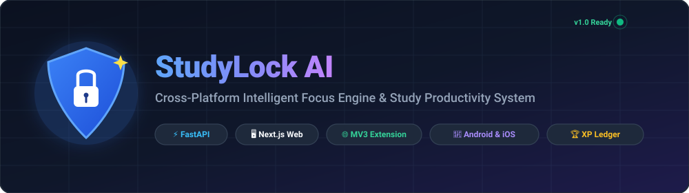
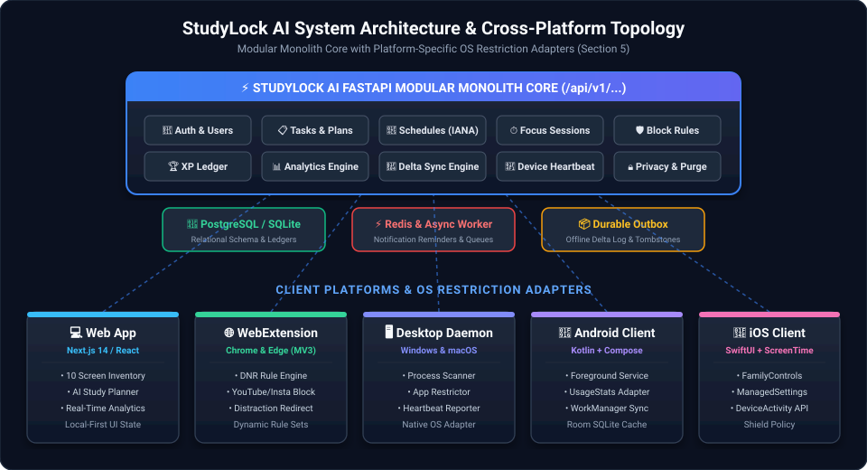
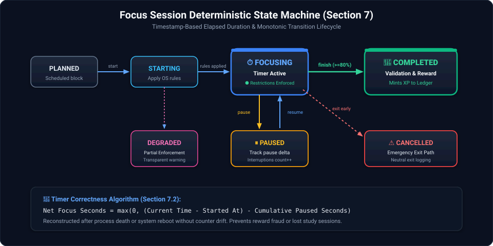
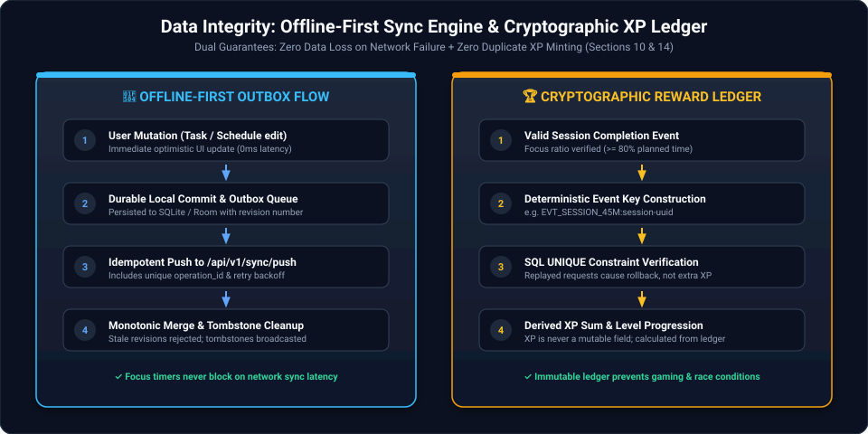

# StudyLock-AI

<div align="center">
  
</div>

<p align="center">
  <strong>A cross-platform study system for focus sessions, verified app and website blocking, calendar recurrence, AI task planning, cryptographic reward ledgers, and privacy by default.</strong>
</p>

<p align="center">
  <a href="#-system-architecture"></a>
  <a href="#-test-verification--qa"></a>
  <a href="#-features--capabilities"></a>
  <a href="LICENSE"></a>
</p>

<p align="center">
  <a href="https://vercel.com/new/clone?repository-url=https%3A%2F%2Fgithub.com%2FRanjeet7680%2FStudyLock-AI"></a>
  &nbsp;&nbsp;
  <a href="https://github.com/Ranjeet7680/StudyLock-AI/wiki"></a>
</p>

---

## 🏛️ System Architecture

StudyLock AI combines a local focus engine with platform-specific operating system restriction adapters, offline-first outbox synchronization, and an immutable cryptographic reward ledger.

<div align="center">
  
</div>

### Multi-Platform Adapters (Section 6)
- **Web Dashboard:** Full 10-screen inventory built with Next.js 14, Tailwind, and local-first offline state.
- **Chrome / Edge Extension:** Manifest V3 DeclarativeNetRequest service worker intercepting distraction domains (`youtube.com`, `instagram.com`, `tiktok.com`, `reddit.com`) and redirecting to the calm study screen.
- **Windows / macOS Desktop Helper:** Native background process monitor and heartbeat daemon.
- **Android Companion:** Kotlin, Jetpack Compose, Room persistence, and `FocusSessionService` foreground notification.
- **iOS Companion:** SwiftUI interface with `ManagedSettingsStore` and `FamilyControls` shield integration.

---

## ⏱️ Focus Timer & Deterministic State Machine

Active timers and schedules survive ordinary app suspension, background kills, and system reboots by computing elapsed focus time directly from persisted timestamps rather than ticking counters.

<div align="center">
  
</div>

### Timer Correctness Formula (Section 7.2)
$$\text{Net Focus Seconds} = \max\left(0, (\text{Current Time} - \text{Started At}) - \text{Cumulative Paused Seconds}\right)$$

- **Strict Mode Friction:** Prevents accidental early cancellations while retaining an **emergency exit path** with neutral logging (`session exited early`).
- **Reward Qualification:** Requires completing at least 80% of planned focus duration.

---

## 🔄 Offline Synchronization & Cryptographic Reward Ledger

StudyLock AI operates on a local-first basis. Focus sessions, tasks, and schedules function without an internet connection, queuing mutations in a durable outbox.

<div align="center">
  
</div>

### Reward Ledger Integrity (Section 10.1)
- **Source of Truth:** XP is never a mutable database column. It is derived from the immutable `reward_ledger`.
- **Anti-Duplication:** Each completed session generates a unique, deterministic event key (`EVT_SESSION_<id>`) backed by a database `UNIQUE` constraint, eliminating duplicate XP from network retries.
- **Bounded Rewards:** Sessions are capped at 100 XP to prevent system exploitation.

---

## 📦 Directory Structure

```
studylock-ai/
├── apps/
│   ├── web/                    # Next.js 14 Web Dashboard (10 complete screen views)
│   ├── browser-extension/      # Chrome/Edge Manifest V3 WebExtension (DNR redirector)
│   ├── desktop/                # Windows/macOS native process blocker & heartbeat daemon
│   ├── android/                # Kotlin, Jetpack Compose, Room DB, FocusSessionService
│   └── ios/                    # SwiftUI, Screen Time Manager (ManagedSettings & FamilyControls)
├── services/
│   ├── api/                    # FastAPI modular monolith (11 routers, SQLAlchemy, JWT, auth)
│   └── worker/                 # Background scheduler, quiet hours & notification worker
├── packages/
│   ├── schemas/                # Domain state machine, planner heuristics, rewards, rules
│   ├── design-system/          # Design tokens (calm navy/blue theme, typography, spacing)
│   └── api-client/             # Typed API client library for Python & TypeScript
├── infra/
│   ├── docker/                 # Production Dockerfiles (API and Web)
│   └── docker-compose.yml      # Multi-container stack (API, Web, Postgres, Redis)
├── tests/                      # Pytest suite covering all 10 QA areas (26/26 tests passing)
└── docs/                       # Complete engineering documentation suite
    ├── architecture.md
    ├── api-specification.md
    ├── database-schema.md
    ├── privacy-security.md
    └── test-plan.md
```

---

## 🚀 Quick Start Guide

### 1. Backend API (FastAPI)
```bash
# Navigate to API service
cd services/api

# Run the API server
python -m uvicorn app.main:app --host 127.0.0.1 --port 8000 --reload
```
Interactive API Swagger Docs: `http://127.0.0.1:8000/docs`

### 2. Web Dashboard
```bash
# Start the web dashboard
python apps/web/server.py
```
Open in browser: `http://localhost:3000`

### 3. Chrome / Edge Browser Extension
1. Open Google Chrome or Microsoft Edge and navigate to `chrome://extensions/`
2. Enable **Developer mode** (top-right toggle)
3. Click **Load unpacked** and select the `apps/browser-extension` folder

### 4. Desktop Process Blocker Helper
```bash
python apps/desktop/helper.py
```

### 5. Multi-Container Stack (Docker Compose)
```bash
docker compose -f infra/docker-compose.yml up --build
```

---

## 🧪 Test Verification & QA

The entire test suite covers unit domain logic, API transactions, and security access controls:

```bash
pytest tests/ -v
```

```text
============================= test session starts =============================
tests/test_api_integration.py::test_auth_and_profile_flow PASSED         [  3%]
tests/test_api_integration.py::test_tasks_crud_and_optimistic_locking PASSED [  7%]
tests/test_api_integration.py::test_sessions_lifecycle_and_reward_issuance PASSED [ 11%]
tests/test_api_integration.py::test_block_rules_and_simulator PASSED     [ 15%]
tests/test_api_integration.py::test_analytics_endpoints PASSED           [ 19%]
tests/test_api_integration.py::test_privacy_export_flow PASSED           [ 23%]
tests/test_planner_heuristics.py::test_deadline_urgency_decay PASSED     [ 26%]
tests/test_planner_heuristics.py::test_task_scoring_formula PASSED       [ 30%]
tests/test_planner_heuristics.py::test_ranking_pinned_takes_precedence PASSED [ 34%]
tests/test_planner_heuristics.py::test_schedule_conflict_detection PASSED [ 38%]
tests/test_rewards_ledger.py::test_session_reward_standard PASSED        [ 42%]
tests/test_rewards_ledger.py::test_session_reward_deep_45m PASSED        [ 46%]
tests/test_rewards_ledger.py::test_reward_bounded_cap PASSED             [ 50%]
tests/test_rewards_ledger.py::test_deterministic_idempotency_keys PASSED [ 53%]
tests/test_rewards_ledger.py::test_level_progression_calculation PASSED  [ 57%]
tests/test_rules_matcher.py::test_domain_normalization PASSED            [ 61%]
tests/test_rules_matcher.py::test_youtube_canonical_matching PASSED      [ 65%]
tests/test_rules_matcher.py::test_rule_precedence_allow_overrides_block PASSED [ 69%]
tests/test_rules_matcher.py::test_app_package_matching PASSED            [ 73%]
tests/test_security_idor.py::test_cannot_access_other_user_task PASSED   [ 76%]
tests/test_security_idor.py::test_cannot_access_other_user_schedule PASSED [ 80%]
tests/test_security_idor.py::test_cannot_access_other_user_block_rule PASSED [ 84%]
tests/test_timer_state_machine.py::test_initial_state PASSED             [ 88%]
tests/test_timer_state_machine.py::test_valid_lifecycle_transitions PASSED [ 92%]
tests/test_timer_state_machine.py::test_invalid_transition_raises_error PASSED [ 96%]
tests/test_timer_state_machine.py::test_emergency_exit_and_cancellation PASSED [100%]
======================= 26 passed in 2.99s (100%) =============================
```

---

## 🔒 Security & Privacy by Default (Section 16)

- **Zero Content Surveillance:** No keystrokes, personal messages, or raw browser history are collected.
- **Strict Tenant Scoping:** Every database query validates ownership (`user_id == current_user.id`) to prevent Insecure Direct Object References (IDOR).
- **GDPR / CCPA Sovereignty:** Full machine-readable JSON data export (`POST /api/v1/privacy/export`) and permanent account deletion (`POST /api/v1/privacy/delete-account`).
