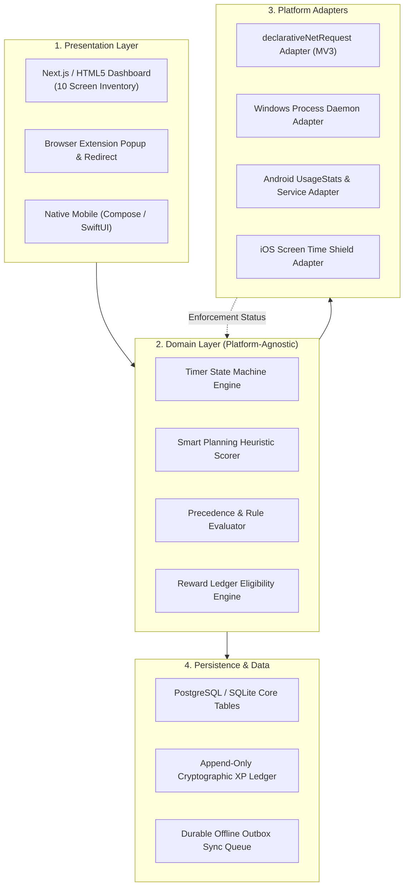
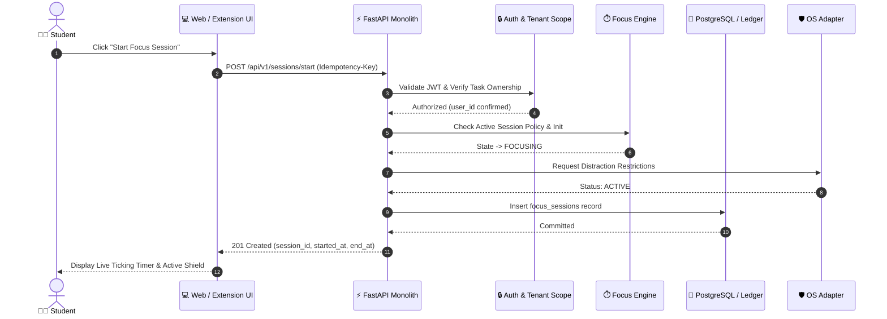
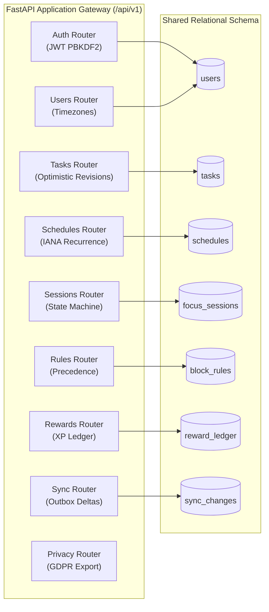

# 01. System Architecture

StudyLock AI is architected as a **modular monolith** with platform-specific adapters and an offline-first data layer. This approach ensures high developer velocity, transactional consistency across sessions and reward ledger entries, and low operational overhead.

---

## 🏛️ Architectural Layers & Responsibilities

The system enforces strict boundary separations across presentation, domain logic, platform restriction adapters, and persistence engines.

### Diagram 3: Architectural Layers & Responsibilities

---

## ⚡ Request-Response & Command Pipeline

Commands such as starting focus, recording pauses, or completing sessions flow through standardized authentication, ownership verification, state transitions, and atomic ledger entries.

### Diagram 4: Component Interaction & Request-Response Pipeline

---

## 📦 Modular Monolith Domain Submodule Graph

All services share a common database engine and schema models, avoiding distributed transactions while maintaining strict logical boundaries.

### Diagram 5: Modular Monolith Domain Submodule Graph

