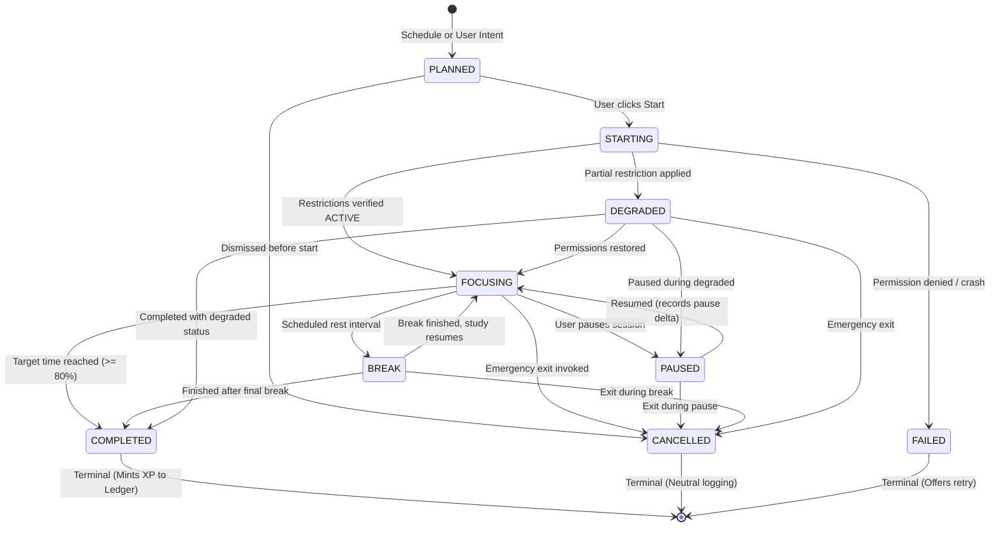
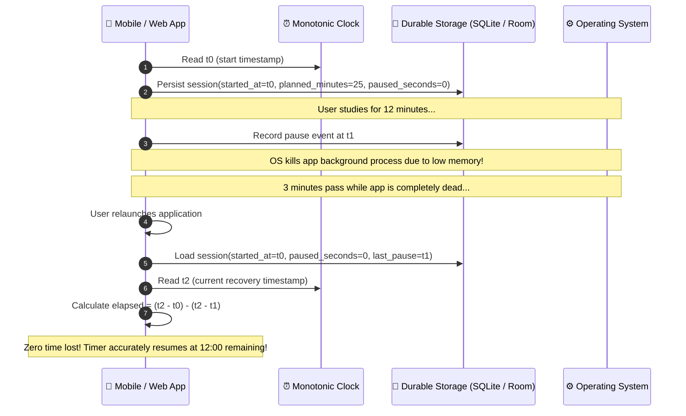
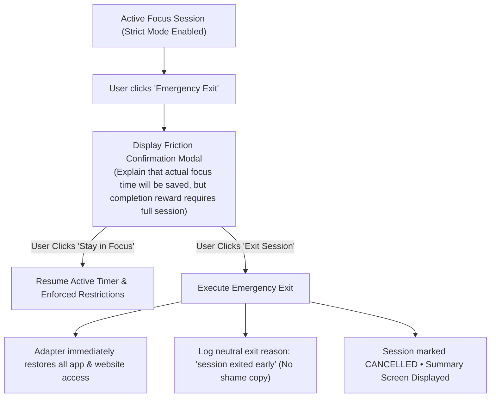

# 02. Focus Session Engine & State Machine

The core focus engine controls the study interval lifecycle, accounting for pauses, breaks, and emergency exits with mathematical precision.

---

## 🔄 Focus Session Finite State Machine

Sessions progress through deterministic states governed by the transitions defined in Section 7.1. Invalid transitions raise structured domain exceptions.

### Diagram 6: Focus Session Finite State Machine Transitions

---

## ⏱️ Monotonic Timer Math & Recovery

StudyLock AI never relies on a ticking counter or setInterval as the sole source of truth. Elapsed time is computed directly from durable timestamps to ensure resilience against app suspension, low-memory process kills, and system reboots.

### Diagram 7: Timer Correctness & Timestamp Recovery Algorithm

$$\text{Net Focus Seconds} = \max\left(0, (\text{Current Time} - \text{Started At}) - \text{Cumulative Paused Seconds}\right)$$

---

## 🔒 Strict Mode Friction & Emergency Exit

Strict mode introduces friction against impulsive cancellation while guaranteeing that the user is never trapped.

### Diagram 8: Strict Mode Friction & Emergency Exit Flow

