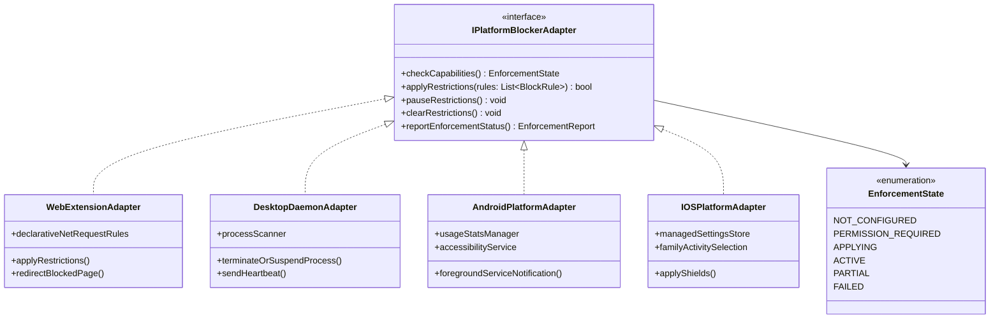
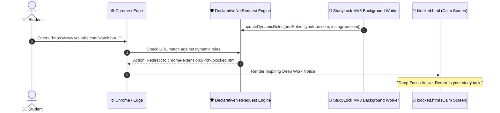
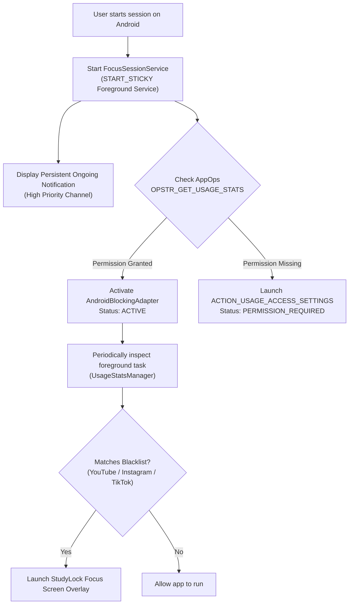
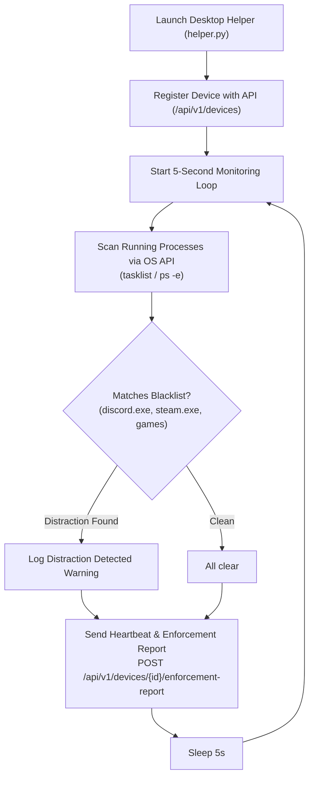
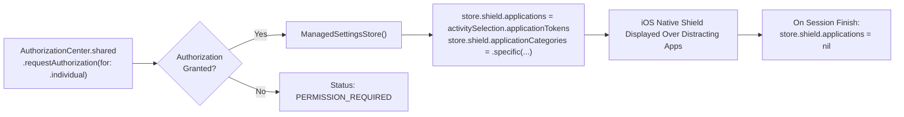

# 03. Platform Enforcement Adapters

StudyLock AI interfaces with operating system restriction primitives through a normalized adapter contract. The domain never assumes parity across operating systems.

---

## 🧩 Platform Adapter Abstraction

Each platform adapter implements capability checks, rule application, pause handling, and health reporting.

### Diagram 9: Platform Adapter Abstraction Layer

---

## 🌐 Chrome / Edge WebExtension (Manifest V3)

The browser extension uses `chrome.declarativeNetRequest` to intercept network requests at the engine level without executing intrusive content-script injections.

### Diagram 10: Chrome/Edge MV3 DeclarativeNetRequest Filter Flow

---

## 🤖 Android Native Integration (Kotlin + Room + Compose)

On Android, the companion app combines a persistent foreground notification service with `UsageStatsManager` and Room database.

### Diagram 11: Android UsageStats & Foreground Service Architecture

---

## 🖥️ Windows & macOS Desktop Daemon Helper

The desktop helper runs as a lightweight daemon inspecting foreground processes and reporting health telemetry to the StudyLock API.

### Diagram 12: Windows Desktop Daemon Process Scan & Heartbeat Loop

---

## 🍎 iOS Screen Time & ManagedSettings Integration

On iOS, StudyLock utilizes Apple's official `FamilyControls` and `ManagedSettings` frameworks.

### Diagram 13: iOS Screen Time FamilyControls Shield Architecture

