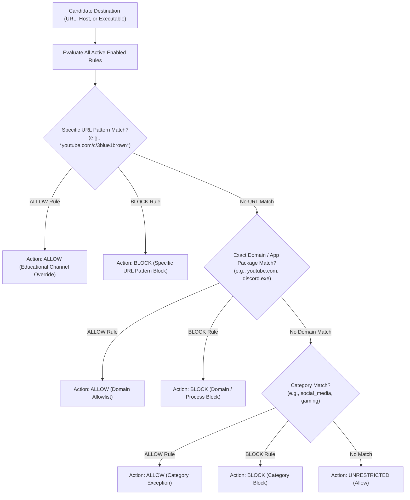
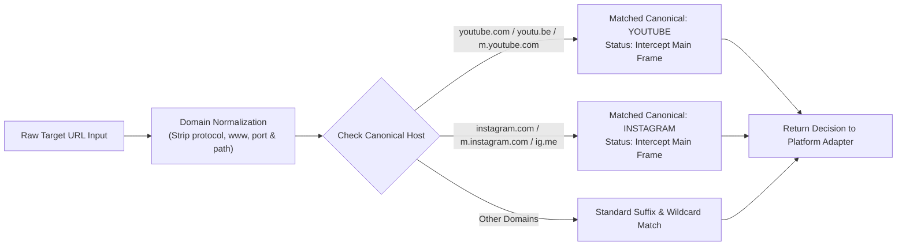

# 04. Rule Engine & Precedence

StudyLock AI utilizes an explicit, deterministic precedence engine so learners understand why a website or application was blocked or allowed.

---

## ⚖️ Precedence Resolution Hierarchy

When candidate URLs or process names match multiple rules, specificity and allow-overrides resolve deterministically.

### Diagram 14: Rule Precedence Resolution Hierarchy

---

## 📺 YouTube & Instagram Distraction Strategy

Popular platforms utilize diverse hostnames, mobile subdomains, and short-links. StudyLock normalizes and canonicalizes destinations.

### Diagram 15: YouTube & Instagram Distraction Matching Workflow

