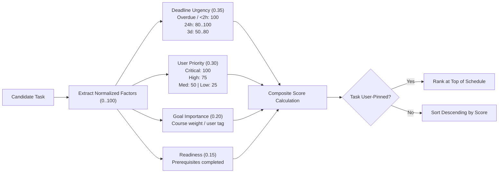
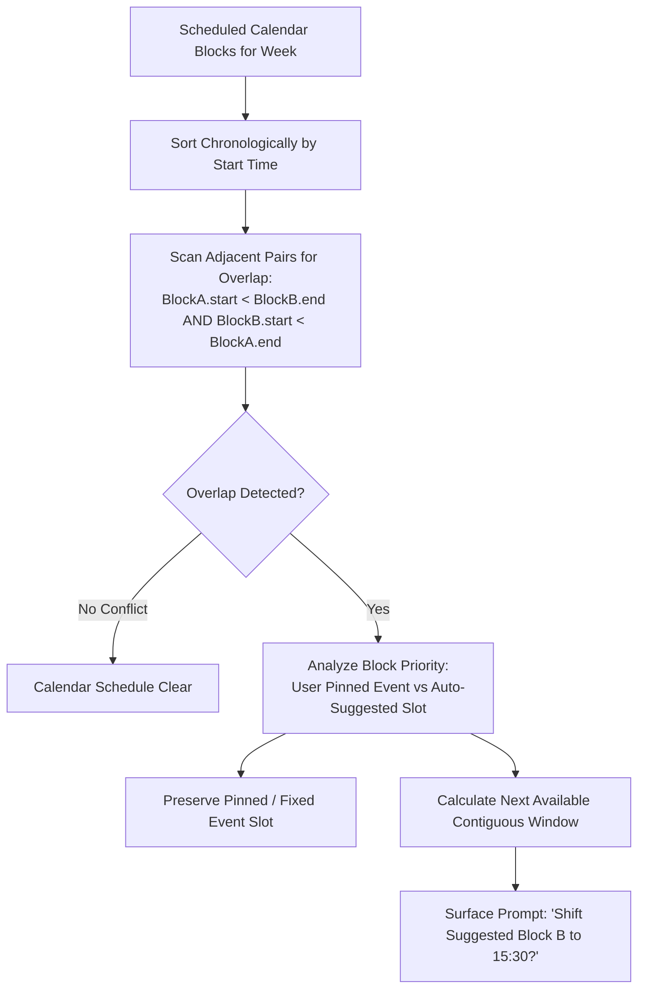
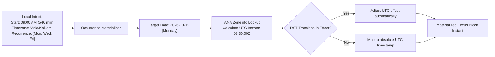

# 05. Calendar Scheduling & AI Planner

StudyLock AI provides automated study schedule generation, overlap conflict detection, and IANA timezone-aware recurrence.

---

## 🎯 Smart Planning Composite Scoring

Candidate study tasks are ranked using a multi-factor heuristic formula defined in Section 8.4:

$$\text{Score} = 0.35 \times \text{Urgency} + 0.30 \times \text{Priority} + 0.20 \times \text{Importance} + 0.15 \times \text{Readiness}$$

### Diagram 16: Smart Planner Composite Scoring Pipeline

---

## 📅 Calendar Overlap Detection & Conflict Engine

The engine identifies conflicting focus blocks and recommends intelligent, non-destructive resolution.

### Diagram 17: Calendar Overlap Detection & Conflict Resolution Flow

---

## 🌍 IANA Timezone Recurrence Lifecycle

Study routines are stored as local calendar intent (e.g., "09:00 AM every Monday") paired with an explicit IANA timezone identifier (e.g., `Asia/Kolkata` or `America/New_York`), avoiding DST transition corruption.

### Diagram 18: IANA Timezone Recurrence Expansion Lifecycle

