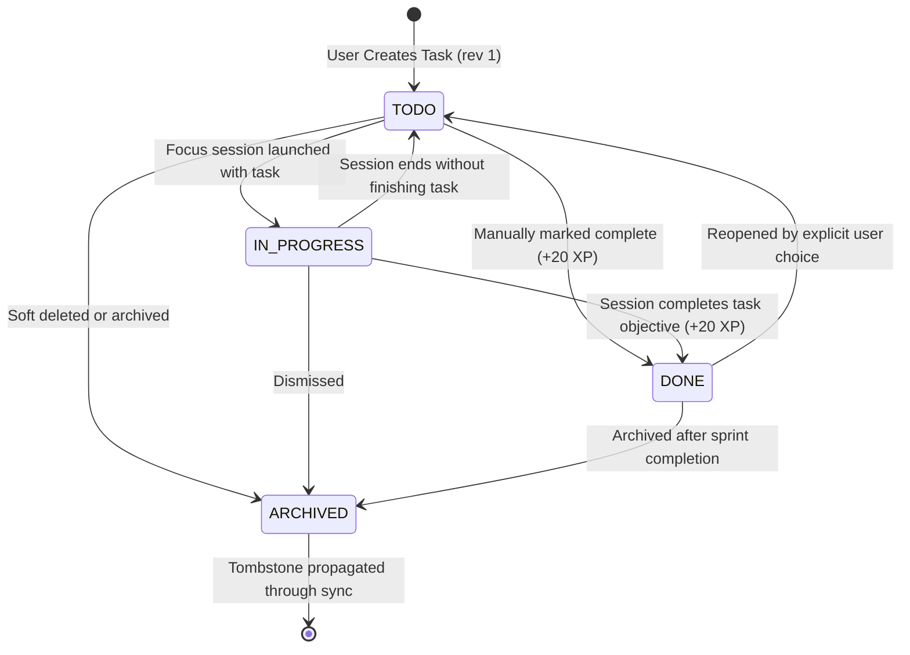
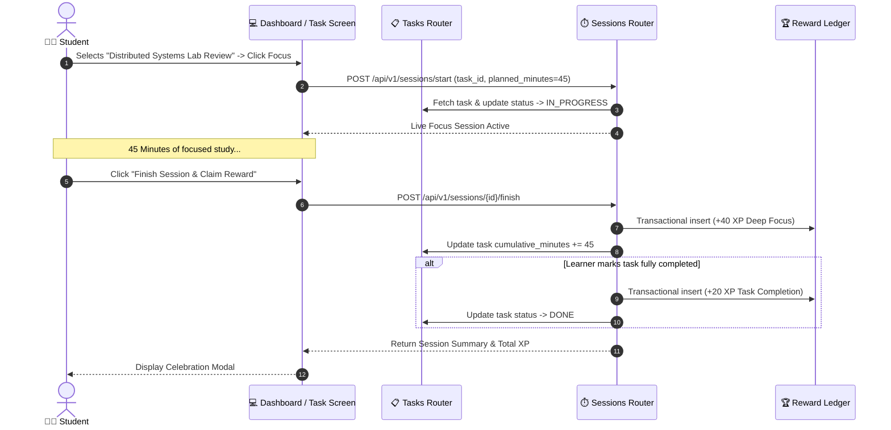

# 06. Tasks & Study Planning

StudyLock AI links discrete learning objectives directly to focus sessions, bridging the gap between broad goals and daily study execution.

---

## 📋 Task Lifecycle & Transition Model

Tasks transition across distinct operational statuses with optimistic revision numbers supporting distributed synchronization.

### Diagram 19: Task Lifecycle & Transition Model

---

## 🔗 Task-Linked Focus Session Orchestration

When a learner initiates focus on a specific task, the system binds the session to the task entity, tracks cumulative study minutes, and auto-completes or logs progress.

### Diagram 20: Task-Linked Focus Session Orchestration

