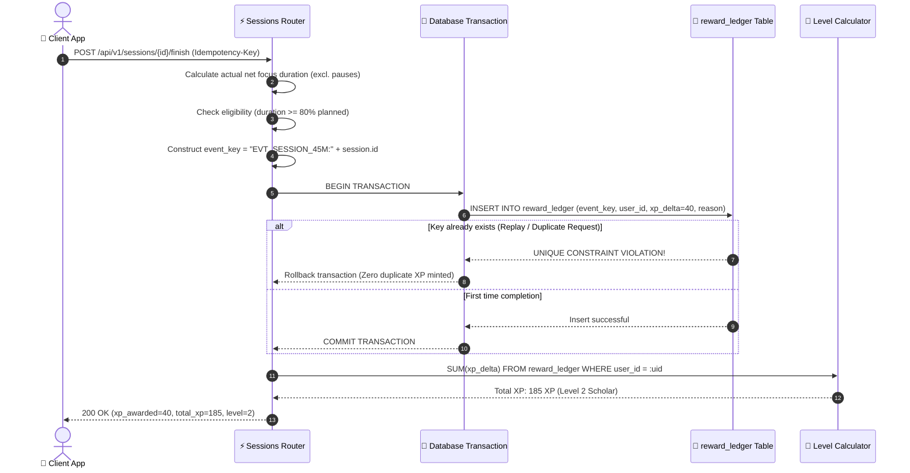
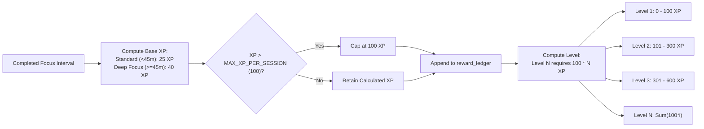

# 07. Cryptographic Reward Ledger & Integrity

StudyLock AI treats user progression with cryptographic integrity. XP is not an arbitrarily editable profile counter; it is the derived sum of an immutable append-only event ledger.

---

## 🔒 Transactional Ledger & Anti-Duplication Pipeline

Every reward event requires a deterministic, unique event key. Database unique constraints and transactional execution guarantee that network retries or replay attacks can never mint duplicate XP.

### Diagram 21: Reward Ledger Transaction & Idempotency Pipeline



---

## 📈 Level Progression & Bounded XP Caps

To maintain game balance and eliminate unhealthy marathon farming, XP per session is bounded at 100 XP, with level thresholds scaling predictably.

### Diagram 22: Level Progression & Bounded XP Mathematical Curve



---

## 🔥 Streak Integrity & Rest Day Forgiveness

StudyLock AI rejects manipulative shame mechanics. Streaks reward learning consistency while providing built-in rest day forgiveness and recovery.

### Diagram 23: Streak Integrity, Grace Periods & Rest Day Forgiveness Flow

```mermaid
flowchart TD
    DayEnd["End of Study Day (23:59 Local Timezone)"] --> CheckFocus{"Qualified Focus Session Recorded Today?"}

    CheckFocus --> |Yes (>= 1 Session)| IncrementStreak["Streak Count++<br/>(Award Milestone Badge at 3, 7, 30 days)"]
    
    CheckFocus --> |No Session| CheckRestDay{"Is Today a Configured Rest Day<br/>OR Streak Freeze Available?"}

    CheckRestDay --> |Yes| Forgive["Maintain Active Streak Unchanged<br/>('Rest Day Honored')"]
    CheckRestDay --> |No| GracePeriod{"Within 24h Grace Period?"}

    GracePeriod --> |Yes| OfferCatchup["Prompt: 'Complete a 25-minute recovery session to preserve streak'"]
    GracePeriod --> |No| GentleReset["Reset to Day 1<br/>Encouraging copy: 'Consistency is built over time' (No shame copy)"]
```
