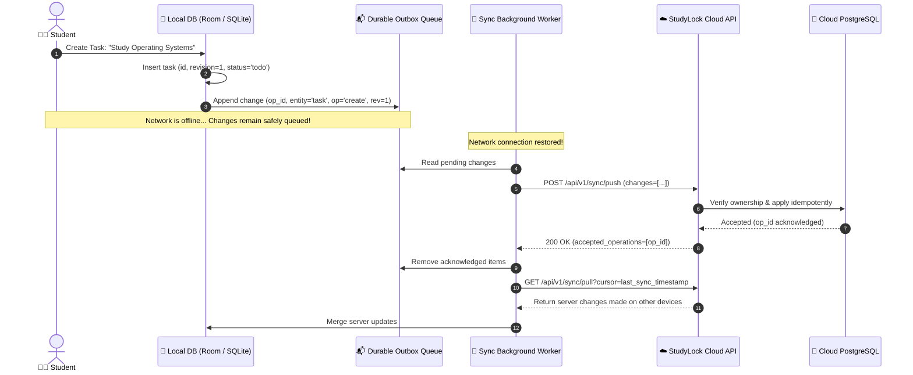
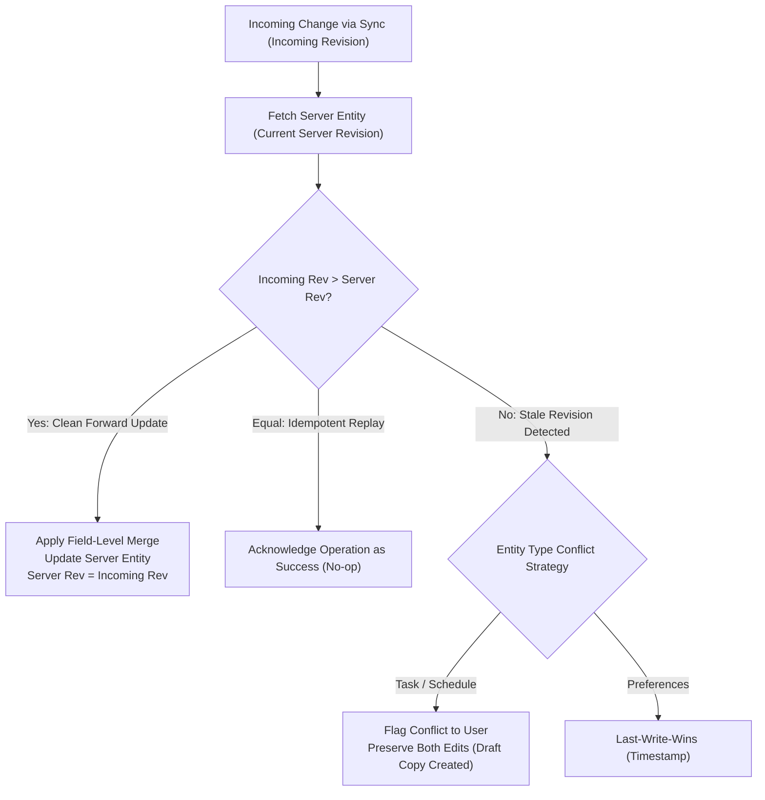
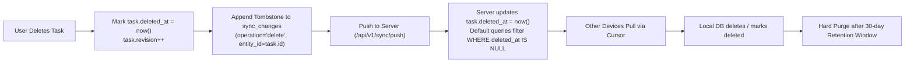

# 08. Offline Sync Engine & Durable Outbox

StudyLock AI is designed from the ground up as a **local-first** application. All core study features—creating tasks, running focus timers, and modifying schedules—operate reliably offline.

---

## 📦 Durable Outbox Replication Architecture

When an action occurs offline, it is written immediately to a local SQLite/Room database and queued into a durable outbox table before asynchronous synchronization.

### Diagram 24: Local-First Durable Outbox Replication Architecture

---

## 🔀 Conflict Resolution & Monotonic Revision Merge

Editable entities (tasks, schedules, rules) carry monotonically increasing `revision` counters. Silent overwrites are prevented via revision comparisons.

### Diagram 25: Conflict Resolution & Monotonic Revision Merge

---

## 🪦 Soft Delete Tombstone Lifecycle

Deleting records offline creates soft-delete tombstones so that deletions propagate accurately to other synced devices rather than resurrecting deleted records.

### Diagram 26: Soft Delete Tombstone Lifecycle & Propagation

