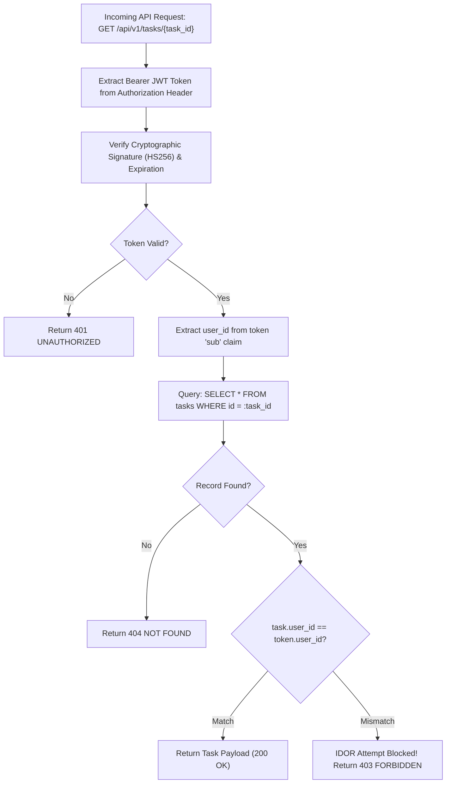

# 09. Security, Privacy & Threat Model

StudyLock AI prioritizes student safety, zero content surveillance, data minimization, and defense against unauthorized data access.

---

## 🛡️ Tenant Isolation & IDOR Prevention

A UUID is an identifier, not authorization. Every database query enforces strict tenant scoping using the verified user ID from the decoded JWT token.

### Diagram 27: Tenant Isolation & IDOR Prevention Security Architecture

---

## 🔒 Zero-Content Surveillance & Data Minimization

StudyLock AI enforces digital boundaries without acting as spyware. Private student communications, search queries, screen video, and keystrokes are never recorded.

### Diagram 28: Zero-Content Surveillance & Data Minimization Pipeline

```mermaid
flowchart LR
    subgraph NotCollected["🚫 Strictly Prohibited Telemetry"]
        direction TB
        X1["Keystrokes / Keylogger"]
        X2["Screen Video / Screenshots"]
        X3["Private Chat / Messages"]
        X4["Full Browser History / Search Queries"]
    end

    subgraph CollectedMin["✅ Minimum Necessary Focus Telemetry"]
        direction TB
        C1["Session start & end timestamps"]
        C2["User task title & subject"]
        C3["Configured block rule domains (e.g., youtube.com)"]
        C4["Device platform & version (for sync)"]
    end

    NotCollected -.-> |Discarded & Filtered| Filter["StudyLock Privacy Boundary"]
    Filter --> CollectedMin
    CollectedMin --> EncryptedStorage["Encrypted Relational Storage (PostgreSQL)"]
```

---

## 🗑️ GDPR & CCPA Data Sovereignty Workflows

Students retain full ownership over their data, including one-click machine-readable JSON exports and complete cascading account purging.

### Diagram 29: GDPR/CCPA Data Export & Cascading Account Deletion Workflow

```mermaid
sequenceDiagram
    autonumber
    actor Student as 🧑‍🎓 Student
    participant API as 🔒 Privacy Router (/api/v1/privacy)
    participant Auth as 🔑 Auth Validator
    participant DB as 🐘 PostgreSQL Database
    participant Audit as 📜 Audit Event Ledger

    rect rgb(30, 41, 59)
    Note over Student,Audit: 1. Full Data Export Workflow
    Student->>API: POST /api/v1/privacy/export
    API->>Auth: Validate authenticated user identity
    API->>DB: Query profile, tasks, schedules, sessions, rules, ledger
    API->>Audit: Log DATA_EXPORT_REQUESTED audit event
    API-->>Student: 200 OK (Machine-Readable JSON Download)
    end

    rect rgb(69, 26, 26)
    Note over Student,Audit: 2. Permanent Account Deletion Workflow
    Student->>API: POST /api/v1/privacy/delete-account (Confirm)
    API->>Auth: Re-authenticate credential check
    API->>DB: DELETE FROM users WHERE id = :current_user.id
    Note over DB: ON DELETE CASCADE immediately wipes all linked tasks, schedules, sessions, devices, and rules!
    API-->>Student: 200 OK ("Account and records permanently deleted")
    end
```

