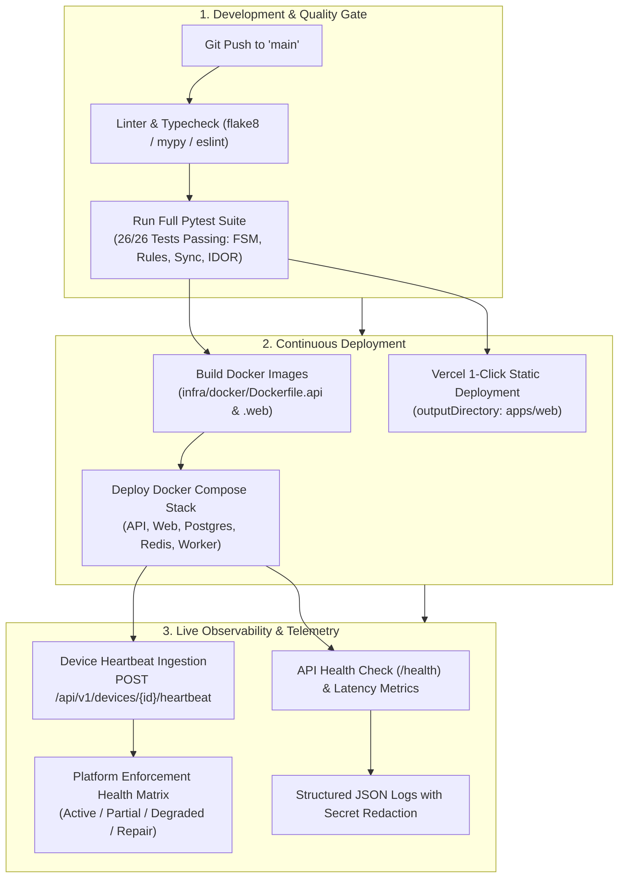

# 10. Observability, Deployment & Operations

StudyLock AI incorporates end-to-end monitoring, device health heartbeats, Docker multi-container composition, and automated Vercel/GitHub CI pipelines.

---

## 🚀 Observability & CI/CD Deployment Pipeline

From local code commit to cloud production deployment, automated pipelines validate types, run all 26 regression test suites, build Docker containers, and trigger instant Vercel previews.

### Diagram 30: Observability, Health Heartbeats & CI/CD Deployment Pipeline



---

## 🛠️ Operations Runbook

### Health Checks
- **HTTP Health:** `GET http://127.0.0.1:8000/health`
  ```json
  {
    "status": "ok",
    "service": "StudyLock AI API",
    "version": "1.0.0",
    "environment": "development"
  }
  ```

### Zero-Downtime Database Migrations
- Schema updates utilize backward-compatible column defaults and revision numbers to support zero-downtime rolling upgrades.

### Redaction Rules
- Authentication tokens, passwords, and user task descriptions are strictly redacted before output to structured application logs.
