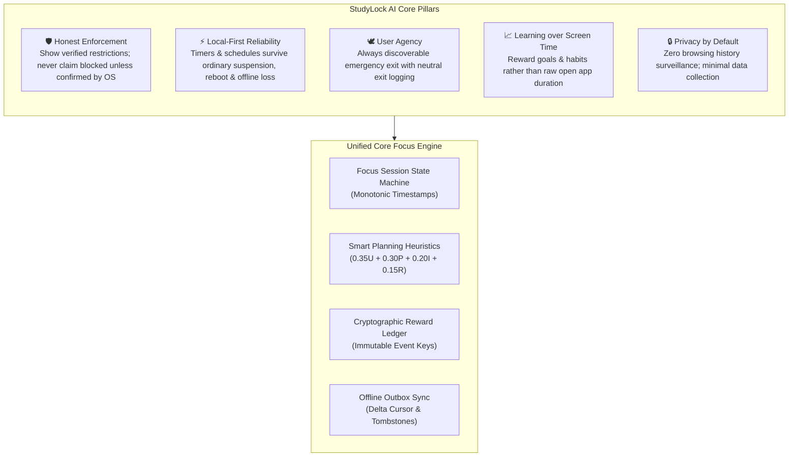
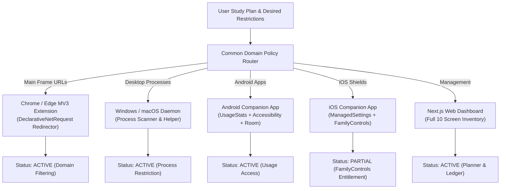

# StudyLock AI — Comprehensive Engineering Wiki

Welcome to the **StudyLock AI** Engineering & Architecture Wiki. This documentation repository provides in-depth specifications, architectural diagrams, operating-system integration strategies, data models, state machines, and operational guidelines conforming to the complete product specification.

---

## 🧭 System Overview & Core Principles

StudyLock AI is a student productivity platform designed to reduce digital distraction while making study planning measurable, transparent, and motivating. It pairs a local focus engine with platform-specific restriction adapters, task/calendar scheduling, progress analytics, and a cryptographic reward ledger.

### Diagram 1: Overall System Vision & Architectural Pillars

---

## 📱 Multi-Platform Adapter Matrix

StudyLock AI recognizes that no single API can control every device. It implements platform-specific adapters reporting exact enforcement states (`ACTIVE`, `PARTIAL`, `PERMISSION_REQUIRED`, `FAILED`).

### Diagram 2: Multi-Platform Capability Matrix & Adapter Topology

---

## 📚 Complete Wiki Documentation Index (30 Diagrams)

| Section | Topic | Diagrams Covered |
|---|---|---|
| **[01. System Architecture](01-System-Architecture)** | Layer boundaries, pipeline, and domain modules | **Diagrams 3, 4, 5** |
| **[02. Focus Session Engine](02-Focus-Session-Engine)** | State machine, monotonic math, and emergency exits | **Diagrams 6, 7, 8** |
| **[03. Platform Enforcement Adapters](03-Platform-Enforcement-Adapters)** | Browser extension, Android, Windows, and iOS adapters | **Diagrams 9, 10, 11, 12, 13** |
| **[04. Rule Engine & Precedence](04-Rule-Engine-and-Precedence)** | Rule precedence hierarchy, YouTube/Instagram matching | **Diagrams 14, 15** |
| **[05. Calendar Scheduling & Planner](05-Calendar-Scheduling-and-Planner)** | Recurrence, IANA timezones, and conflict detection | **Diagrams 16, 17, 18** |
| **[06. Tasks & Study Planning](06-Tasks-and-Study-Planning)** | Lifecycle states and task-linked focus sessions | **Diagrams 19, 20** |
| **[07. Cryptographic Reward Ledger](07-Cryptographic-Reward-Ledger)** | Idempotent XP issuance, streaks, and progression | **Diagrams 21, 22, 23** |
| **[08. Offline Sync Engine](08-Offline-Sync-Engine)** | Durable outbox, conflict merges, and tombstones | **Diagrams 24, 25, 26** |
| **[09. Security, Privacy & Threat Model](09-Security-Privacy-and-Threat-Model)** | IDOR checks, data sovereignty, and GDPR purge | **Diagrams 27, 28, 29** |
| **[10. Observability, Deployment & CI/CD](10-Observability-Deployment-and-Operations)** | Observability metrics, heartbeats, and Vercel/Docker CI | **Diagram 30** |
